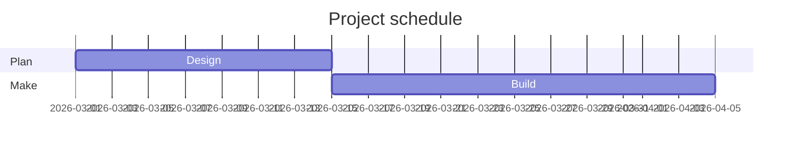

# Accessibility fixture

A first paragraph with *emphasis*, **strong text**, `inline code`, ==marked text== and a [link to example.com](https://example.com).

## Lists

- Tight item one
- Tight item two
  - Nested item
- Tight item three

1. First step
2. Second step

- Loose item one

- Loose item two

## Quotes and code

> A block quotation that spans a sentence or two.

```js
const answer = 42;
```

### Table

| Name | Value |
| --- | --- |
| Alpha | 1 |
| Beta | 2 |

A table without a header row:

|:--|--:|
| Gamma | 3 |
| Delta | 4 |

#### Figure


/red.svg "A red square, as a content block"

## Diagrams



/flow.mmd "How a request is handled"

---

A closing paragraph with a footnote.[^1]

[^1]: The footnote text.

+++

A paragraph on a page of its own, after a page break.
