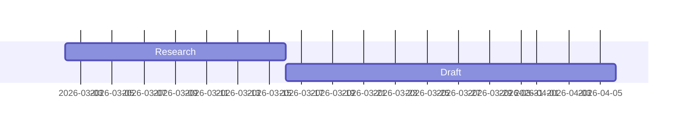

# File formats

Everything is stored as plain files so the library can be browsed in Finder, synced, and opened in other editors.

## Library

```
<Library>/
  .mdeditor/library.json          {"format": 1, "created": "...", "seededThemes": ["Classic", ...]}
  Collections/<Collection>/<Project>/...
  Templates/<Template>/...
  Themes/<Theme>/theme.css        plus any fonts or images the theme references
  Themes/<Theme>/includes/        the theme's components (name.html, optional name.css)
  Themes/<Theme>/theme.json       optional settings: {"pageIncludes": ["footer.html"]}
  Guides/Voices/<Name>.md         voice guides
  Guides/Styles/<Name>.md         style guides (see STYLE-GUIDES.md)
```

- `seededThemes` in `library.json` lists the themes that come with the app and have been added to this library. Each is added once, so a theme deleted from the library is not added again; a library without the list was given Classic and Modern.
- A **collection** is any folder in `Collections/`.
- A **project** is any folder inside a collection. Everything inside it (any depth of folders) belongs to the project.
- A **template** is a project folder in `Templates/`. New projects copy it, except its history and AI log. Templates are made from projects (**New Template from Project…**) and used from **New Project from Template…**; they are not listed in the sidebar.

## Project metadata

`<Project>/.mdeditor/project.json`

```json
{
  "format": 1,
  "kind": "project",
  "created": "2026-10-20T19:00:00.000Z",
  "theme": "Classic",
  "lastExport": "main.md",
  "references": ["References/RFP.pdf", "References/Addendum 1.docx"],
  "exportArrangements": {
    "main.md": [
      { "kind": "pdf", "path": "Inserts/Cover letter.pdf", "title": "Cover letter" },
      { "kind": "document" },
      { "kind": "pdf", "path": "forms/W-9.pdf", "pages": "1", "title": "Form W-9" }
    ]
  }
}
```

`voice` and `style` name the project's guides. A document can override `theme`, `voice` and `style` in its front matter.

`references` lists the project files the AI reads with each request (see *Reference files* below). `exportArrangements` holds, per document, the PDFs placed before and after it in its PDF export (see *Export arrangement*).

`<Project>/.mdeditor/chat.json` holds the project's Assistant conversation: `{"format": 1, "turns": [{"role": "user" | "assistant", "content": "...", "doc": "main.md", "model": "...", "error": true, "time": "ISO 8601"}]}` (`doc`, `model`, `error` and `time` are optional). The last 1,000 turns are kept. The library's `Themes/`, `Guides/` and root `.mdeditor/` folders hold the conversations for themes, guides, and for when no document is open. The file is not versioned, not included in ZIP exports, and not copied into templates or projects made from them.

`<Project>/.mdeditor/ai-log.jsonl` records AI text accepted into the project's documents (time, document, model, prompt, text), one JSON object per line. *Refine from edits* uses it to compare drafts with how they read now. Like the chat, it is the writer's own and is not included in ZIP exports.

Project-specific theme copies live in `<Project>/.mdeditor/themes/<Theme>/theme.css` and take precedence over the library theme with the same name.

## Documents

Markdown (CommonMark plus tables, strikethrough, footnotes, raw HTML), with three extensions of the app's:

- `==marked text==` is shown highlighted (`<mark>`), as in iA Writer, Obsidian and Typora.
- `+++` on a line of its own (three or more plus signs) is a page break. Like a `***` rule it may follow a line of text directly; inside code it is text.
- A table may start with its separator row (`|:--|:--|`) instead of a header row; it then has no header cells. A separator row directly under a line of text keeps its standard meaning (that line is the header, or the text is a paragraph).

Other markdown tools show them as plain text. Optional YAML front matter:

```markdown
---
title: Annual Report
client: Acme
date: October 2026
theme: Modern        # overrides the project theme for this document
lang: en-GB          # document language for the PDF (default: en)
---
```

### Variables

- `{{name}}` in markdown is replaced with the value. Not replaced inside code spans or fenced code. `\{{name}}` produces a literal `{{name}}`.
- Nested YAML maps use dotted names: `client: {name: Acme}` → `{{client.name}}`; lists are joined with commas (`{{tags}}` → `news, updates`). Component templates also get each list as a list, to loop over (THEMES.md, *Lists and loops*).
- Built-ins (front matter can override): `today` (e.g. October 20, 2026), `today-iso` (2026-10-20), `project`, `collection`, `filename`.
- Variables are not substituted inside front matter values (decided in iteration 2: front matter stays literal so other apps read the same values).
- A transcluded document inherits the including document's variables. Its own front matter overrides them for itself and the documents it includes.

### Content blocks (transclusion)

Follows iA's [Markdown Content Blocks](https://github.com/iainc/Markdown-Content-Blocks) spec v0.4, also accepting paths that start with `./` or `../`:

```
/Chapter 1.md
../shared/intro.md
/images/figure.png "Caption"
/data/sales.csv 'Table caption'
/code/example.py (Caption)
https://example.com/photo.jpg "Online image"
```

- The line must contain only the path and an optional title, indented by at most three spaces.
- Paths are relative to the folder of the document containing the line; a leading `/` means that folder, not the disk root.
- `.md`, `.markdown`, `.txt` and similar are rendered as markdown; images become figures; `.csv`/`.tsv` become tables (first row is the header); `.mmd`/`.mermaid` become diagrams; recognised code files become highlighted code blocks.
- Lines inside fenced code are ignored. Missing files, circular includes and unsupported types show a dashed box in the preview and are listed before PDF export.
- Paths must stay inside the project folder; a content block pointing outside it shows a box and a warning instead of the file, so history and ZIP exports always hold everything a document uses. A symbolic link that leads outside the library counts as missing.

### PDF pages

A content block that names a PDF puts that PDF's pages into the exported PDF, page for page, at that point of the document. The pages are not edited or re-typeset; each one fills a page of its own, at its own size, without the theme's headers and footers.

```
/forms/W-9.pdf "Form W-9"
/forms/W-9.pdf#pages=3,1-2 "Form W-9"
```

- `#pages=` chooses pages and their order: `3,1-2` is page 3, then pages 1 and 2; `4-2` runs backwards; `5-` runs to the end. Without it, every page is included in order. **Choose PDF Pages…** in the line's context menu picks them from thumbnails and writes the selection; **Insert into Document** in a PDF's sidebar menu adds the line.
- The title is the description screen readers hear for each page ("Form W-9, page 1 of 3"). Form fields are flattened into the page (their current values are printed, not editable).
- The preview shows the pages as images; the export copies the pages themselves. Each copied page is tagged as one figure with the description; the PDF's own tags are not carried over (see ACCESSIBILITY.md).
- Encrypted PDFs cannot be inserted. A PDF whose fonts are not embedded can be, but the export is then not marked PDF/UA (see ACCESSIBILITY.md).

### Components

``, as in Jekyll: a line of its own is a block, inside a paragraph it is inline. `page-includes: footer.html` (or a list, or `none`) in the root document's front matter sets the components shown on every page. Templates and parameters are described in THEMES.md.

### Inline images

**Insert Inline Image** (right-click in the editor) writes an image the height of the text around it, for a logo in a sentence:

```html

```

The description starts as the file name; change it to say what the image shows.

### Diagrams

A fenced code block with the language `mermaid`, or a `.mmd` / `.mermaid` content block, is drawn as a [Mermaid](https://mermaid.js.org) diagram (flowcharts, Gantt charts, timelines and the other Mermaid types). `accTitle:` and `accDescr:` lines describe it for screen readers; a content block's title is its caption.

````markdown

````

### Authorship annotations

Compatible with iA's [Markdown Annotations](https://github.com/iainc/markdown-annotations) v0.2: a block at the end of the file listing which character ranges were written by a human (`@`), by AI (`&`) or are references (`*`), with a SHA-256 hash of the text. The editor hides the block, keeps the ranges aligned as text is edited, and rewrites the block and hash on save. The block is never rendered in the preview or PDF.

- Text you type is attributed to `@<your name>` (Settings › General); text inserted from the AI to `&<model>`; pasted text is left unattributed because its author is unknown. Undo restores attribution along with the text.
- A block is written only to files that already have one or that contain AI text, so ordinary files stay unchanged.
- AI-written text is shown dimmed; ⇧⌘A or the status bar switches the dimming off and on. Settings › General can stop recording authorship.

If the hash does not match (the file was edited elsewhere), the ranges are kept and a notice says they may be misplaced.

## Reference files

Files the AI reads with each Assistant, ⌘K and review request in a project: an RFP and its addenda, a brief, notes. **Add files…** in the Assistant panel (or **Add AI Reference Files…** in a project's sidebar menu) copies them into `<Project>/References/`; any project file can be ticked with **Use as AI Reference**. The ticked files are listed in `references` in `project.json`.

- PDF, Word (`.docx`), text (`.txt`, `.json`), markdown, CSV/TSV and images (PNG, JPEG, GIF, WebP).
- Claude receives PDFs as documents (it reads their layout and images) and images as images. Other services receive the extracted text, and images as image parts, which the service's model must accept. PDFs over 20 MB or 500 pages in total are sent as extracted text.
- With Claude, the files are cached between requests for a few minutes, so a long RFP is not paid for in full each time.
- Review with AI also lists requirements in the references that the document does not address.

## Export arrangement

**Export PDF…** shows the document with any PDFs to place before or after it: a cover letter, signed forms, appendices. Each part has its pages (chosen from thumbnails), its order and a description for screen readers. The arrangement is saved per document in `exportArrangements` in `project.json` and used for later exports of that document. PDFs chosen from outside the project are copied into `<Project>/Inserts/`.

Page numbers in the document's own headers and footers count the document's pages, including PDF pages inserted with content blocks, but not the parts placed before or after it.

## Version history

`<Project>/.mdeditor/history.mdh`: one append-only binary file per project, chosen over a git object store because a single file syncs more reliably through iCloud Drive, Dropbox or Google Drive. The library's `Themes/` and `Guides/` folders each have one too (`Themes/.mdeditor/history.mdh`, `Guides/.mdeditor/history.mdh`), covering all themes or all guides; the History panel shows it when a theme or guide is open.

```
file     = "MDEHIST1\n" record*
record   = type:u8  length:u32 (big-endian)  payload  crc32(type + payload):u32
type 1   = blob:     sha256 (32 bytes) + deflate(file content)
type 2   = snapshot: deflate(JSON)
```

Snapshot JSON:

```json
{ "id": "mgz…", "time": 1792523000000, "kind": "checkpoint", "name": "Sent to client",
  "parent": "mgy…", "files": { "main.md": { "h": "<sha256>", "s": 1234 } } }
```

- `kind`: `auto` (after 2 minutes without changes, and on quit), `checkpoint` (named by you), `export` (each PDF export), `restore`.
- Content is stored once per unique file content, so unchanged files and images cost nothing in later snapshots.
- Versioned: every project file plus `.mdeditor/project.json` and `.mdeditor/themes/`. Not versioned: other hidden files.
- A damaged tail (e.g. an interrupted write) is ignored and trimmed on the next write; so is a file cut off before the end of its header. A file whose header is not a history header is renamed `history.mdh.unreadable-<time>` and a new history starts.
- Versions are data: a file name in a version that leads outside the project (`../`, an absolute path) is not restored.
- Restoring a project or file first records the current state, so a restore can itself be undone.
- **Pruning.** Checkpoints, exports and restores are kept. Automatic versions are all kept for a day, then the last one of each day for 30 days, then the last one of each week; the first and latest versions are always kept. When 25 or more automatic versions are due to go, the file is rewritten without them (to a temporary file, then renamed).
- **Two Macs.** When two Macs change the history file at once, sync services keep both and rename one (`history 2.mdh` in iCloud Drive, `history (… conflicted copy …).mdh` in Dropbox, `history (1).mdh`, `history-<Mac>.mdh`). The next time the history is read or written, the versions from all copies are merged into `history.mdh` in time order and the copies are moved to the Trash.

## Finder tags

The coloured dots in the library are macOS Finder tags, stored on the files themselves (the extended attribute `com.apple.metadata:_kMDItemUserTags`, a binary property list of `Name\nColour` strings), so Finder shows the same tags and they move with the files. The app reads and writes them with `/usr/bin/xattr`. Turning a colour off removes every tag of that colour, including tags with other names that Finder gave that colour.

## Theme packages

`.mdtheme`: a zip of a theme folder (`theme.css`, `fonts/`, `images/` and any other images, `includes/`, `theme.json`) plus `mdtheme.json` (`{"format": 1, "name": "…", "fontsByName": [...]}`). Images the theme's CSS takes from elsewhere in the library are added under `images/` (renamed `name 2.ext` on a clash) with the packaged CSS rewritten to point there. Import refuses packages with absolute paths or `..`, packages larger than 100 MB, and packages that unpack to more than 300 MB.

## Web page export

One `.html` file: the composed document in `<main>`, the theme's CSS plus a one-column screen layout, diagrams as inline SVG, PDF pages inserted with content blocks as PNG images, and every local image and font as a `data:` URI. The page carries a Content-Security-Policy that allows no scripts, as in the preview: raw HTML in a document is shown, not run.

## Settings

`~/Library/Application Support/Folio Dome/settings.json`: library path, last open document, and preferences (author name, editor font, checks, AI services without keys).

`~/Library/Application Support/Folio Dome/secrets.json`: API keys, each encrypted with Electron `safeStorage` (key held in the macOS Keychain).
