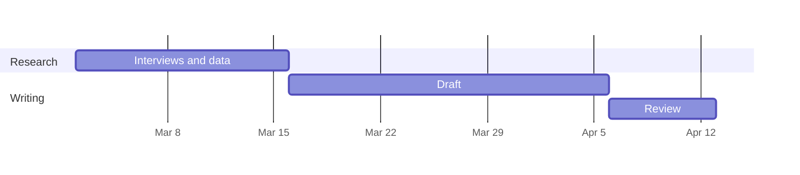

# {{title}}

This document shows what the editor and its themes can do. Toggle the preview with ⌘R.

## Variables

Values set in the front matter at the top of a document can be used anywhere as `{{name}}`. This document’s author is “{{author}}”. Built-in values include today’s date ({{today}}), the project ({{project}}) and the collection ({{collection}}).

Themes can show variables in fixed page areas. The Classic theme puts `title` in the top-left header, `section` in the top-right header and `date` in the footer, with page numbers on the right.

## Content blocks

A line containing only a path to another file includes that file, using the same syntax as iA Writer. Paths are relative to the document.

/chapters/details.md

## Tables from CSV

/assets/sales.csv "Sales by region"

## Code files

/assets/example.py "A small Python script"

## Images

/assets/diagram.svg "How a project is exported"

## Diagrams

Diagrams are written in [Mermaid](https://mermaid.js.org) and drawn in the theme’s font. The `accTitle` and `accDescr` lines become the diagram’s description for screen readers in the PDF.

A diagram can also be its own file, included like any content block: `/assets/process.mmd "Caption"`.

## Quotes and dashes

Quotes typed in prose become curly as you type: “like this” and it’s. Two hyphens become an en dash (8–24 weeks) and three an em dash. Inside HTML tags they stay straight: hover text, and in code: `print("hi")`. A line of only hyphens stays a rule. To convert pasted or older text, use Edit › Convert Quotes and Dashes.

## Writing help

Press ⌘K to ask the AI to write at the cursor or rewrite a selection. The Assistant panel holds a conversation about the document, and Insights shows readability, headline scores and an AI review against this project’s voice and style guides.

## Footnotes

Footnotes are numbered automatically.[^1]

[^1]: This is the footnote text.
